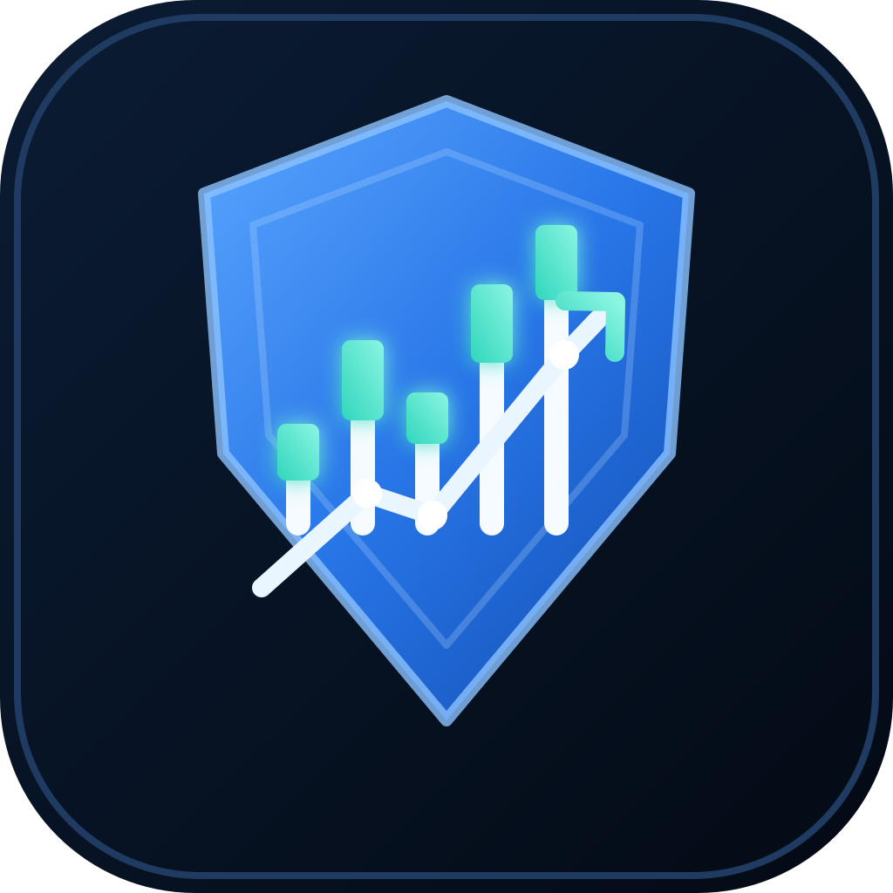
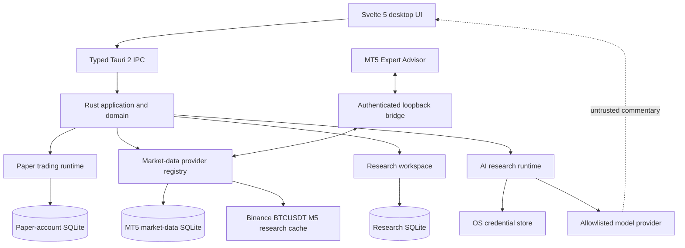

<!-- The README describes the verified implementation, not the full product vision. -->
<div align="center">



# Agentic Trading OS

**Research with evidence. See risk across the account. Keep execution under control.**

A local-first trading research desktop built with **Rust · Tauri 2 · Svelte 5**.

[Get started](#get-started) · [Explore capabilities](#what-atos-can-do) · [Architecture](#architecture) · [Documentation](#documentation)

[](https://github.com/Reivhell/ATOS/actions/workflows/ci.yml)
[](CHANGELOG.md)
[](https://www.rust-lang.org/)
[](https://tauri.app/)
[](https://svelte.dev/)

</div>

> [!CAUTION]
> **ATOS v0.11.0 is an engineering/source milestone, not a production-certified trading system.** The MT5 Expert Advisor is read-only. It does not submit, amend, close, or cancel broker orders. Research results, risk calculations, and margin preflight must not be treated as a guarantee of trading outcomes or broker acceptance.

## Start here

| I want to… | Go to |
|---|---|
| Install and launch the desktop app | [Get started](#get-started) |
| Understand what is implemented today | [What ATOS can do](#what-atos-can-do) |
| Check supported data and instruments | [Data coverage and source boundaries](#data-coverage-and-source-boundaries) |
| Understand account-wide MT5 risk | [Account-wide risk workflow](#account-wide-risk-workflow) |
| Inspect design and trust boundaries | [Architecture](#architecture) |
| Run tests and validation | [Verification](#verification) |
| Find a specific engineering document | [Documentation](#documentation) |

<details>
<summary><strong>New to ATOS? Read this first</strong></summary>

ATOS is a desktop workspace for market research, technical analysis, backtesting, MT5 account telemetry, paper trading, and AI-assisted investigation.

Three design rules shape the system:

1. **Rust owns the authoritative state.** The UI presents data and sends typed requests; it is not the security or risk boundary.
2. **Data keeps its identity.** Provider, broker/account context, observation time, freshness, revisions, and dataset fingerprints remain explicit. Unsupported data requests fail instead of silently switching to another source.
3. **AI does not get trading authority.** Model output is untrusted research commentary. Deterministic application policy remains in control.

</details>

## What ATOS can do

ATOS is built as a local desktop application. These are the current capabilities and their practical boundaries—not a promise that every item in the wider product roadmap is complete.

| Area | Current capability | Important boundary |
|---|---|---|
| **MT5 bridge** | Authenticated local telemetry for account state, positions, pending orders, ticks, closed candles, instrument specifications, and broker-reported trading sessions | Read-only; same-machine loopback connection |
| **Account-wide risk** | Aggregates stop risk across open positions and active pending orders, checks protection state, calculates risk-budget headroom, and evaluates candidate sizing | Snapshot-based calculation; not an order-submission system |
| **Margin preflight** | Uses terminal-native margin and P/L calculations and binds results to the validated account snapshot | Indicative projection; it does not reserve margin or guarantee server acceptance |
| **Market data** | Rust-native provider registry, authenticated MT5 context, and a bounded public Binance research dataset | The public Binance candle series currently supported for native research is BTCUSDT 5-minute |
| **Backtesting and Research Lab** | Deterministic SMA research, dataset fingerprints, chronological out-of-sample evaluation, and a bounded nested parameter tournament | Current native research workflow is limited to BTCUSDT 5-minute candles |
| **Technical analysis** | Searchable catalog of 364 concepts plus a bounded set of implemented calculators and research detectors | 364 is the catalog size, not 364 fully implemented indicators |
| **Meme Coin Screener** | Discovery from GeckoTerminal and DEX Screener feeds, with separate momentum and risk heuristics | Feed coverage is promotion-biased; heuristic scores are not probabilities or safety ratings |
| **AI research** | Allowlisted providers, OS credential-store integration, bounded output, and auditable research runs | Model output is advisory; a cloud run sends its selected research context to the chosen provider |
| **Local research API** | Optional Bun/Hono API for bounded research requests | Loopback-only, bearer-token protected, and has no order routes |

### Explore a capability

<details>
<summary><strong>MT5 telemetry and account-wide risk</strong></summary>

The local bridge uses protocol v6 and authenticates the terminal session against the broker server and account identity. It transports bounded account snapshots and market-data batches to the Rust application.

The account-wide risk control plane considers the complete reported inventory—not only the chart symbol:

- Open-position stop risk is measured from the current mark to the recorded stop-loss, so floating P/L already included in equity is not counted twice.
- Pending-order stop risk is measured from its activation/entry reference because the pending order is not yet reflected in floating P/L.
- Unprotected or unresolved exposure blocks additional risk.
- The current ATOS account-wide stop-risk ceiling is **5% of equity**. Candidate sizing is constrained by both the requested trade-risk budget and the remaining account headroom.
- Candidate margin and stop-loss P/L are calculated by the terminal and checked against the exact authenticated snapshot sequence.

The bridge rejects incomplete or inconsistent inventories rather than reporting a truncated account as complete. See the [account-wide risk engineering audit](docs/ATOS_MT5_ACCOUNT_WIDE_RISK_CONTROL_ENGINEERING_AUDIT_2026-10-31.md) and [bridge security and operations](docs/MT5_BRIDGE_SECURITY_AND_OPERATIONS.md).

</details>

<details>
<summary><strong>Backtesting and nested walk-forward research</strong></summary>

The native Research Lab binds a run to the exact supported BTCUSDT 5-minute candle dataset, its SHA-256 fingerprint, and the observed date range.

The nested parameter tournament:

1. Builds a bounded neighborhood of up to 25 SMA parameter pairs.
2. Selects a candidate from each expanding training window using training evidence only.
3. Evaluates the selected candidate on the next chronological, unseen test window.
4. Stores fold evidence, selected parameters, out-of-sample results, blockers, and caveats in a separate research workspace.

The current workflow requests three outer test folds. A research gate means that stored evidence passed its configured research policy; it does not authorize paper or live orders and does not prove that a strategy will remain profitable.

See [Research Workspace v0.10.1](docs/RESEARCH_WORKSPACE_0.10.1.md) and [testing and acceptance](docs/09_TESTING_AND_ACCEPTANCE.md).

</details>

<details>
<summary><strong>Meme Coin Screener</strong></summary>

The current discovery path uses GeckoTerminal new/trending pools and DEX Screener token-profile/latest-boost feeds. Enrichment is bounded across Solana, Ethereum, Base, BNB Chain, Arbitrum, Polygon, Optimism, and Avalanche.

The `momentum-risk-v1` model keeps momentum and risk as separate heuristics. It considers available price windows, activity, liquidity, pool age, turnover, and missing evidence. It is not calibrated as a probability of future returns.

Discovery feeds are not an unbiased token universe. Promotion bias, incomplete provider coverage, unknown holder or liquidity-lock evidence, and unavailable executable-depth data must remain visible. “Unknown” does not mean “safe.”

See the [screener specification](docs/04_MEMECOIN_SCREENER.md).

</details>

<details>
<summary><strong>AI-assisted research and privacy</strong></summary>

Provider credentials are stored through the operating-system credential store. The runtime uses an allowlist rather than accepting arbitrary remote provider URLs; local Ollama use is loopback-only.

When a cloud research run is invoked, market snapshots, candle values, symbols, and the bounded request context are sent to the selected model provider. Only use datasets whose disclosure to that provider is permitted, and review that provider's retention and data-processing terms.

Provider output is untrusted commentary. It cannot set authoritative risk limits, create order authority, or submit trades. Imported model artifacts are registered and checked; that does not mean ATOS executes those imported files.

See [AI runtime and security policy](SECURITY.md).

</details>

## Data coverage and source boundaries

ATOS deliberately distinguishes broker context, public research data, and token discovery. They are not interchangeable.

| Data lane | Current scope | What ATOS does not infer |
|---|---|---|
| **Authenticated MT5** | Account-bound telemetry, subscribed symbols/timeframes, closed-bar history, ticks, instrument specifications, and broker-reported weekly sessions | It does not infer missing history, broker timezone, holidays, or remote-terminal support |
| **Binance public data** | BTCUSDT 5-minute cached candles for research/backtesting | It cannot answer MT5 broker-context queries or silently substitute another symbol/timeframe |
| **Token discovery** | GeckoTerminal new/trending pools and DEX Screener promoted/latest-boosted discovery feeds | It is not a complete token universe, independent market-price oracle, or full contract/holder/liquidity safety analysis |

### MT5 connection boundary

The Rust listener binds to `127.0.0.1:47650` and accepts a local terminal session. The pairing credential is held through the OS credential store, but the loopback TCP transport is **not encrypted in transit**. Do not forward the port, tunnel it to another machine, or expose the bridge on a network interface.

### Data integrity principles

- Provider identity and broker/account identity are validated at the Rust boundary.
- Observation time is distinct from cache-ingestion time.
- Unknown freshness or incomplete data fails closed where it affects a risk-increasing decision.
- Dataset fingerprints identify the exact encoded dataset; they are not provider signatures or proof of source authenticity.
- There is no automatic cross-provider fallback that can silently change the meaning of a query.

## Architecture

ATOS is a **local modular monolith**, not a distributed agent platform. The frontend communicates with Rust through typed Tauri commands. Rust owns persistence, risk policy, market-data validation, backtesting, research state, and provider boundaries.



### Why the boundaries matter

| Component | Owns |
|---|---|
| **Svelte presentation** | Views, user interaction, and display of returned state |
| **Tauri adapters** | Typed IPC transport and command registration |
| **Rust domain/application** | Business invariants, calculations, validation, and use-case orchestration |
| **TradingCore** | Local paper-account state, risk checks, and paper-order lifecycle |
| **MT5 bridge and store** | Authenticated telemetry, durable tick/candle receipts, series cursors, and broker data provenance |
| **ResearchWorkspace** | Separate research persistence, hypotheses, workflows, run cards, and research evidence |
| **AgentRuntime** | Provider/keyring boundary and bounded research commentary |

The three local SQLite stores are deliberately separate: paper-account state, MT5 market data, and research evidence do not share one mutable account payload.

<details>
<summary><strong>Source tree map</strong></summary>

| Path | Responsibility |
|---|---|
| `src-tauri/src/domain/` | Domain contracts and invariants |
| `src-tauri/src/application/` | Market-data, backtest, research, and analysis use cases |
| `src-tauri/src/runtime/trading_core.rs` | Paper-account aggregate, risk enforcement, persistence lifecycle |
| `src-tauri/src/infrastructure/mt5/` | Authenticated MT5 transport and durable market-data store |
| `src-tauri/src/infrastructure/ai/` | AI provider orchestration, credential lifecycle, and agent runtime |
| `src-tauri/src/adapters/tauri/` | Tauri bootstrap and typed IPC adapters |
| `src/lib/domain/` | Frontend domain contracts and policies |
| `src/lib/engines/` | Deterministic calculations and research/decision engines |
| `src/lib/application/` | Frontend use-case orchestration |
| `src/lib/components/` | Svelte presentation components |
| `api/src/` | Optional Bun/Hono local research API |
| `MQL5/Experts/ATOS_Bridge.mq5` | Read-only MT5 Expert Advisor |

</details>

## Get started

### Requirements

- **Node.js 20+**
- **Rust toolchain 1.99.1** (pinned in `rust-toolchain.toml`)
- **Tauri native build prerequisites** for your operating system ([Tauri 2 setup guide](https://v2.tauri.app/start/prerequisites/))
- **Bun** for the optional Hono research API and Bun compatibility tests
- **MetaTrader 5 + MetaEditor** only when installing and validating the MT5 bridge on a real terminal

### 1. Clone the repository

```bash
git clone https://github.com/Reivhell/ATOS.git
cd ATOS
```

### 2. Install dependencies

```bash
npm ci --no-audit --fund=false
bun install --frozen-lockfile
```

Bun is needed for the optional API and Bun-specific test workflow. The Tauri desktop app uses the Node/Rust toolchains and the committed lockfiles.

### 3. Launch the desktop application

```bash
npm run tauri dev
```

This starts the Vite development server through the Tauri configuration and opens the native desktop window. The ordinary browser runtime is intentionally not a substitute for the Rust desktop runtime; account, risk, and other native operations require the desktop app.

### 4. Build the desktop bundle

```bash
npm run tauri build
```

A successful local build does not by itself certify the MT5 Expert Advisor, a broker connection, or packaged installs on every supported operating system.

### Optional: run the local research API

```bash
npm run dev:api
# Or run without the development watcher:
npm run start:api
```

The Bun/Hono API is a separate local service. It binds to loopback, requires a bearer token, has bounded request handling, and does not expose order routes. Do not proxy it to the public internet. See [API security hardening](docs/API_SECURITY_HARDENING_0.5.9.md).

## Verification

Run the checks relevant to the files you changed:

```bash
npm run verify:repo
npm test
npm run typecheck:layers
npm run build

cargo fmt --manifest-path src-tauri/Cargo.toml --all -- --check
cargo test --manifest-path src-tauri/Cargo.toml --all-targets
cargo clippy --manifest-path src-tauri/Cargo.toml --all-targets --all-features -- -D warnings
```

The repository CI workflow also checks Bun compatibility, frontend type/build, Rust formatting/tests/Clippy, and source-level guardrails. Tagged release jobs add platform builds and artifact provenance checks.

### Latest recorded verification

The current implementation status records the following results on **2026-11-01**:

| Check | Recorded result |
|---|---|
| `npm run build` | Passed |
| `npx svelte-check` | 0 errors, 0 warnings |
| `cargo check --all-targets` | Passed |
| `cargo test --all-targets` | 239 passed |
| `npm test` | Passed (15/15 reported checks) |
| `npm run verify:repo` | Passed |

These are dated repository records, not a live acceptance certificate. MetaEditor compilation, real-terminal behavior, broker-specific margin behavior, and packaged cross-platform operator acceptance remain separate gates. Check the live [CI workflow](https://github.com/Reivhell/ATOS/actions/workflows/ci.yml) for current automation status.

## Safety model and known limitations

<details open>
<summary><strong>Read before connecting a terminal or using research output</strong></summary>

- **No live order execution.** The current EA is read-only. There is no broker order submission, amendment, close, cancellation, or order-reservation API.
- **Risk is snapshot-based.** Positions, pending orders, quotes, and account state may change immediately after a calculation.
- **Margin preflight is not an order check.** It does not call broker `OrderCheck`, reserve margin, or guarantee subsequent server acceptance. Broker-specific margin tiers and hedged treatment may differ.
- **Stop-risk is not total loss risk.** Current calculations do not cover every commission, swap, financing charge, widened spread, slippage, gap, failed stop execution, or broker liquidation outcome.
- **Missing evidence is not low risk.** Unprotected or unresolved MT5 exposure blocks additional risk; unknown screener contract/holder/liquidity evidence must not be interpreted as safe.
- **Backtests are models.** Results depend on dataset quality, assumptions, costs, and execution simplifications. They are not forecasts or proof of profitability.
- **AI output is untrusted.** Models cannot override deterministic risk policy or acquire order authority.
- **Local bridge only.** The MT5 bridge is unauthenticated for remote use by design and its loopback transport is not encrypted; do not expose or tunnel it.
- **Not production-certified.** Native release qualification, MetaEditor compilation, terminal/broker acceptance, and platform-specific operational testing must be completed before production approval.

</details>

## Documentation

### Product and engineering foundations

| Topic | Document |
|---|---|
| Product goals and user journeys | [Product requirements](docs/01_PRD.md) |
| Scope and requirements | [Scope and requirements](docs/02_SCOPE_AND_REQUIREMENTS.md) |
| Component boundaries and ownership | [System architecture](docs/03_SYSTEM_ARCHITECTURE.md) |
| UI behavior and visual direction | [UI/UX specification](docs/05_UI_UX_SPEC.md) |
| Data models and events | [Data model and events](docs/06_DATA_MODEL_AND_EVENTS.md) |
| Testing strategy and acceptance | [Testing and acceptance](docs/09_TESTING_AND_ACCEPTANCE.md) |
| Roadmap and deferred work | [Implementation roadmap](docs/10_ROADMAP.md) |
| Current implementation and validation state | [Implementation status](docs/IMPLEMENTATION_STATUS.md) |

### Market data, trading risk, and research

| Topic | Document |
|---|---|
| Screener discovery and score limitations | [Meme Coin Screener](docs/04_MEMECOIN_SCREENER.md) |
| Security and trading-risk policy | [Security and trading risk](docs/08_SECURITY_AND_TRADING_RISK.md) |
| MT5 bridge installation and trust boundary | [MT5 bridge security and operations](docs/MT5_BRIDGE_SECURITY_AND_OPERATIONS.md) |
| MT5 market-data validation | [MT5 market-data assurance](docs/MT5_MARKET_DATA_ASSURANCE_AND_QUERY.md) |
| Account-wide stop-risk and margin preflight | [MT5 account-wide risk audit](docs/ATOS_MT5_ACCOUNT_WIDE_RISK_CONTROL_ENGINEERING_AUDIT_2026-10-31.md) |
| Research runs and nested walk-forward tournament | [Research Workspace v0.10.1](docs/RESEARCH_WORKSPACE_0.10.1.md) |
| Technical-analysis catalog | [Technical-analysis catalog](docs/13_TECHNICAL_ANALYSIS_CATALOG.md) |

### Operations and release

| Topic | Document |
|---|---|
| First run, recovery, and operator checks | [Operations guide](docs/OPERATIONS.md) |
| Release evidence and attestations | [Release attestation pipeline](docs/RELEASE_ATTESTATION_PIPELINE_0.9.6.md) |
| Version history | [Changelog](CHANGELOG.md) |
| Security reporting and handling | [Security policy](SECURITY.md) |
| All documentation files | [Documentation directory](docs/) |

## Contributing

Contributions should preserve the separation between presentation, domain policy, infrastructure, and execution boundaries.

Before opening a pull request:

1. Explain the behavior being changed and the reason for it.
2. Add regression tests for normal, stale, invalid, and failure cases where relevant.
3. Run the applicable Node, Rust, frontend, and repository checks.
4. State which checks could not be run—especially MetaEditor, native packaging, terminal, and broker acceptance.
5. Update the relevant engineering documentation when data contracts, risk behavior, or trust boundaries change.

Do not describe a source-level test pass as broker or production acceptance.

## Security

Do not commit credentials, API keys, trading account exports, wallet secrets, or private financial data. For vulnerability reports and handling guidance, read [SECURITY.md](SECURITY.md). Keep the MT5 bridge and optional local API restricted to loopback.

<div align="center">

[Back to top](#agentic-trading-os)

</div>
