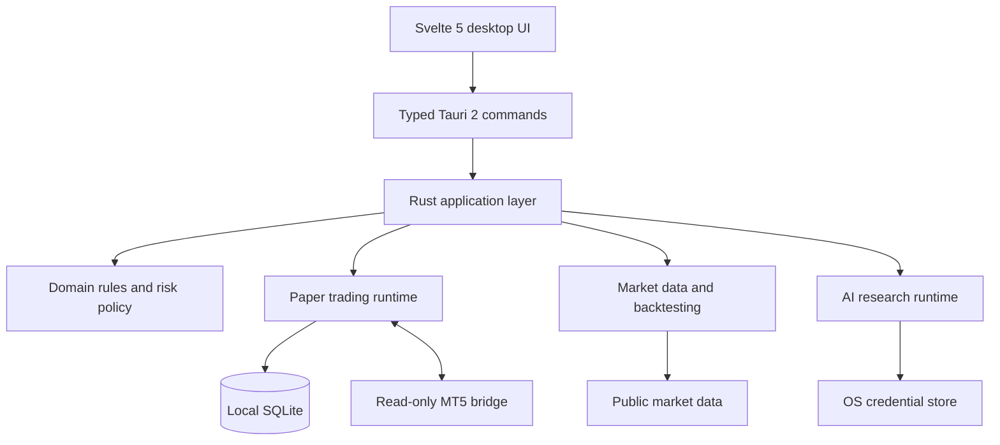

<!-- Keep the opening focused: what ATOS is, what it can do, and its safety boundary. -->
<div align="center">

# Agentic Trading OS

**Research markets. Test ideas. Inspect risk. Keep execution under human control.**

A local-first trading research desktop built with **Rust · Tauri 2 · Svelte 5**.

[Explore the docs](docs/01_PRD.md) · [System architecture](docs/03_SYSTEM_ARCHITECTURE.md) · [Security & risk](docs/08_SECURITY_AND_TRADING_RISK.md) · [Report a bug](https://github.com/Reivhell/ATOS/issues)

[](https://github.com/Reivhell/ATOS)
[](https://github.com/Reivhell/ATOS)
[](https://tauri.app/)
[](docs/08_SECURITY_AND_TRADING_RISK.md)

</div>

> [!WARNING]
> **ATOS is not certified for production trading.** The MT5 bridge is read-only and does not submit, modify, close, or cancel broker orders. Test results in this README are repository-reported checks, not broker or production acceptance.

## Find your way around

<details open>
<summary><strong>I want to try ATOS locally</strong></summary>

1. Install Node.js 20+, Bun, and the Rust toolchain.
2. Clone the repository and install dependencies.
3. Run the frontend, tests, and repository guardrails.

See [Getting started](#getting-started) for commands and prerequisites.
</details>

<details>
<summary><strong>I want to understand the architecture</strong></summary>

Start with the [system architecture](docs/03_SYSTEM_ARCHITECTURE.md), then inspect the [product requirements](docs/01_PRD.md). The short version: Svelte presents the workspace, typed Tauri commands connect it to Rust, and Rust owns authoritative application state and risk decisions.
</details>

<details>
<summary><strong>I want to review risk and security</strong></summary>

Read [Security and trading risk](docs/08_SECURITY_AND_TRADING_RISK.md) and [MT5 market-data assurance](docs/MT5_MARKET_DATA_ASSURANCE_AND_QUERY.md). Pay particular attention to stale snapshots, incomplete inventories, stop-risk assumptions, and broker-specific margin behavior.
</details>

<details>
<summary><strong>I want to contribute</strong></summary>

Review the architecture and acceptance criteria first. Submit changes with the checks you ran and clearly identify any native, MetaEditor, terminal, or broker validation you could not perform.
</details>

## What is ATOS?

ATOS is a local desktop workspace for market-data inspection, MT5 account telemetry, strategy backtesting, paper-account controls, and AI-assisted research. It is designed to make data and risk decisions inspectable rather than giving an AI agent unchecked trading authority.

### What you can do

| Capability | What it is for |
|---|---|
| Market data | Inspect normalized data, freshness, and source provenance |
| MT5 telemetry | Ingest read-only terminal data and inspect historical ticks and candles |
| Account-wide risk | Aggregate stop-risk across open positions and active pending orders; inspect protection state and risk-budget headroom |
| Margin preflight | Estimate candidate margin using terminal-native calculations where supported |
| Backtesting | Run deterministic research workflows with out-of-sample windows and dataset fingerprints |
| AI research | Use allowlisted providers and bounded commentary without granting execution authority |
| Auditability | Persist local state with SHA-256 hash-chained commits and a tamper-evident audit trail |

## How the pieces fit together



**Ownership matters:** the UI displays state; it is not the authority for risk decisions. AI-generated analysis is advisory. The MT5 bridge provides telemetry and does not execute trades.

<details>
<summary><strong>Explore the codebase by responsibility</strong></summary>

| Path | Responsibility |
|---|---|
| `src-tauri/src/domain/` | Domain models, invariants, and state-transition policy |
| `src-tauri/src/application/` | Backtesting, market-data queries, and research use cases |
| `src-tauri/src/runtime/trading_core.rs` | Paper-account state, risk enforcement, and persistence lifecycle |
| `src-tauri/src/infrastructure/mt5/` | MT5 telemetry transport and durable market-data ingestion |
| `src-tauri/src/infrastructure/ai/` | AI provider orchestration, credential handling, and agent runtime |
| `src-tauri/src/adapters/tauri/` | Tauri bootstrap and typed command adapters |
| `src/lib/` | Frontend domain, engines, services, adapters, and presentation |
| `MQL5/Experts/ATOS_Bridge.mq5` | Read-only MetaTrader 5 terminal bridge |

</details>

## Getting started

### Prerequisites

- Node.js 20 or newer
- Bun for the Hono research API
- Rust toolchain for the native backend
- MetaTrader 5 and MetaEditor when validating the bridge on a real terminal

### 1. Clone and install

```bash
git clone https://github.com/Reivhell/ATOS.git
cd ATOS

npm ci --no-audit --fund=false
bun install --frozen-lockfile
```

### 2. Run the frontend

```bash
npm run dev
```

Run the local research API separately when needed:

```bash
bun run api/src/server.ts
```

### 3. Verify your changes

```bash
npm run build
npm test
cargo test --all-targets
npm run verify:repo
```

<details>
<summary><strong>What do these checks tell me?</strong></summary>

- `npm run build` checks the frontend production build.
- `npm test` runs the JavaScript/TypeScript test suite.
- `cargo test --all-targets` runs Rust tests for the selected targets.
- `npm run verify:repo` runs repository-specific guardrails.

A successful frontend build or source-level test run does not prove that the complete native desktop app, MQL5 bridge, or broker integration is ready for release. Use the repository lockfiles and supported native build environment.
</details>

## Verification snapshot

Recorded repository results dated **2026-11-01**:

| Check | Recorded result |
|---|---|
| Frontend build | Passed |
| TypeScript layer checks | Passed |
| Rust formatting | Passed |
| Rust Clippy | No errors |
| Rust tests | 239 passed |
| Node tests | 375 passed across 52 suites |
| Repository guardrails | Passed |
| Release preflight | Passed |

These results are a snapshot, not a live CI feed. They do not establish acceptance across operating systems, MT5 terminal versions, or brokers.

## Safety model and known limits

<details open>
<summary><strong>Read before using account or market data</strong></summary>

- **No live order execution.** The current EA is read-only; no order submission, modification, close, cancellation, or order-reservation API is provided.
- **Risk checks must fail closed.** Stale or invalid data, incomplete account inventories, unresolved stop risk, and inconsistent snapshots must not be treated as permission to increase exposure.
- **Stop-risk is an estimate.** It cannot capture every commission, swap, financing charge, spread change, slippage event, price gap, failed stop execution, or broker liquidation rule.
- **Margin preflight is not a reservation.** Terminal-calculated candidate margin can differ from server-side rules, aggregate tiers, and hedged-position treatment. It does not guarantee that a later order would be accepted.
- **Snapshots age.** Account and order state can change immediately after calculation.
- **Keep the bridge local.** Do not expose the MT5 bridge on a network interface. Remote-terminal support needs a separately reviewed transport and security design.
- **Production approval is outstanding.** Native builds, MQL5 compilation, real-terminal and broker acceptance, crash/persistence testing, credential-store validation, and release packaging require their own evidence.

Do not use real trading credentials or rely on ATOS for live trading while production certification is outstanding.
</details>

## Documentation map

| If you need… | Read |
|---|---|
| Product scope and user journeys | [Product requirements](docs/01_PRD.md) |
| Component boundaries and runtime ownership | [System architecture](docs/03_SYSTEM_ARCHITECTURE.md) |
| Threats, security posture, and risk controls | [Security and trading risk](docs/08_SECURITY_AND_TRADING_RISK.md) |
| Test strategy and acceptance criteria | [Testing and acceptance](docs/09_TESTING_AND_ACCEPTANCE.md) |
| Planned work and product direction | [Roadmap](docs/10_ROADMAP.md) |
| Release evidence and attestation | [Release attestation pipeline](docs/RELEASE_ATTESTATION_PIPELINE_0.9.6.md) |
| MT5 data validation and query behavior | [MT5 market-data assurance](docs/MT5_MARKET_DATA_ASSURANCE_AND_QUERY.md) |
| Historical engineering reports | [Archived reports](docs/archive/) |

## Contributing

Contributions should preserve ATOS's safety boundaries and architectural rules. Before opening a pull request, describe the problem and intended behavior, run the relevant checks, and report any validation that was not possible. Do not present source-level checks as native or broker acceptance.

## License and security

Review the repository's license files for reuse terms. For security concerns and disclosure guidance, see [SECURITY.md](SECURITY.md).

<div align="center">

[Back to top](#agentic-trading-os)

</div>
